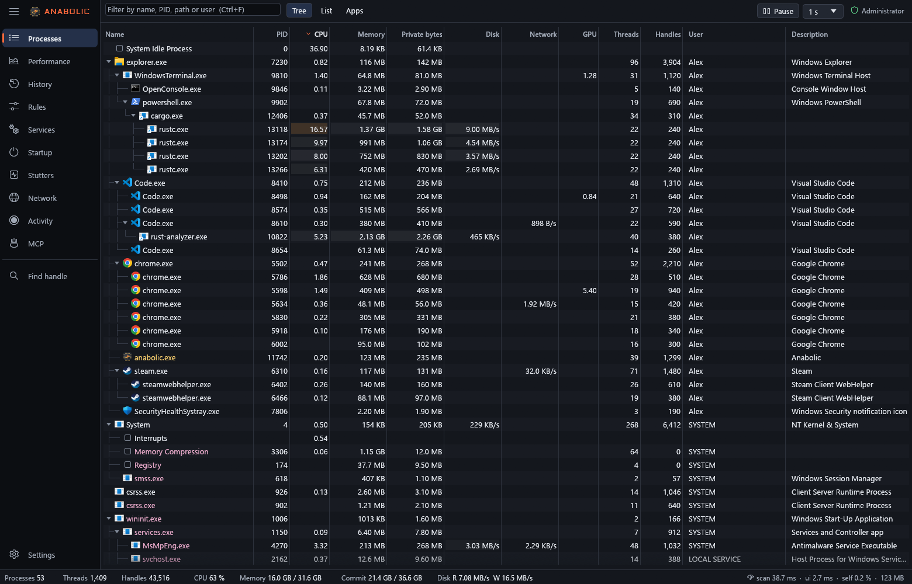
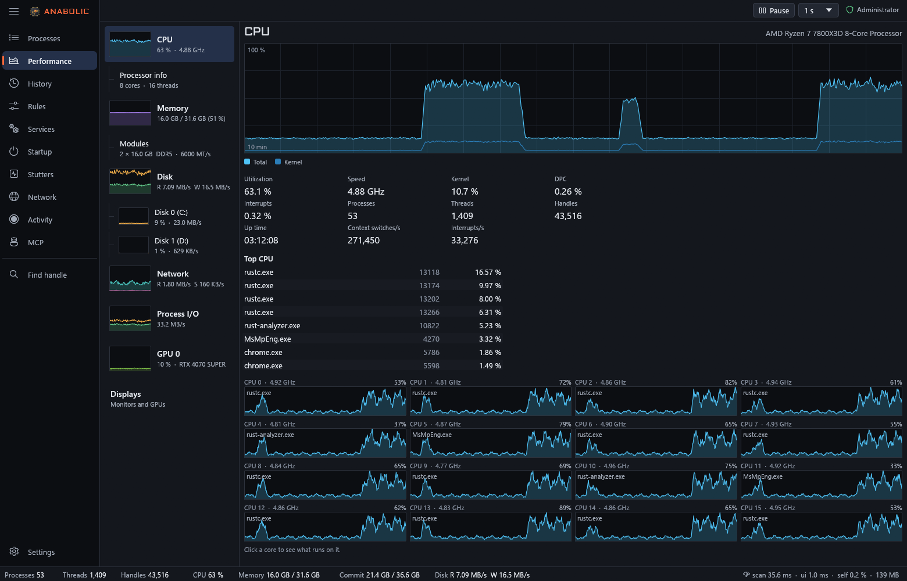

<p align="center">
  
</p>

<h3 align="center">Task Manager on steroids</h3>

<p align="center">
  A Windows task manager that stays responsive when the machine does not,<br>
  and answers <em>who is doing this, and why</em>, not only <em>how much</em>.
</p>

<p align="center">
  <a href="https://github.com/RaptorTwentyOne/Anabolic/actions/workflows/ci.yml"></a>
  <a href="https://github.com/RaptorTwentyOne/Anabolic/releases"></a>
  
  
  <a href="#license"></a>
</p>

---

You open a task manager when something is wrong: a game stutters, the fans
spin up, a disk sits at 100 % and nothing says why. That is exactly when most
of them freeze, and when they do answer, they say *how much*, not *who* or
*why*. Anabolic is built for that moment:

- **It stays alive under load.** It raises its own priority, opts out of
  efficiency throttling, keeps its memory resident, never blocks its
  interface thread and reads the system once per refresh: about 1 ms of CPU
  per frame while scrolling. A running instance comes to the front in under
  100 ms.
- **It says who and why.** Who ran on each CPU core; which process reads and
  writes which file on each disk; traffic and GPU per program; which program
  started a process and how; what a hung thread waits for; which handles keep
  a dead process from going away.
- **It watches without touching.** Its regular views read system-wide tables
  and kernel traces: no process is opened, read or injected into, so a game
  is left alone while it is watched. Anything that does open a process asks
  first and says why.
- **It is honest about what it measures.** A value it cannot read is shown as
  unavailable, with the reason, never as zero.



## Contents

- [What it does](#what-it-does)
- [Getting started](#getting-started)
- [Keyboard](#keyboard)
- [AI assistants (MCP)](#ai-assistants-mcp)
- [Games and anti-cheat](#games-and-anti-cheat)
- [Privacy](#privacy)
- [Building from source](#building-from-source)
- [License](#license)

## What it does

| Page | |
|---|---|
| **Processes** | A tree, a flat list or grouped by app, with CPU, memory, disk, network, GPU, handles, user and command line. End, end tree, suspend, priority, cores, efficiency mode. Details show threads with their call stacks, modules with their signatures and hashes, handles in words, network connections, the services a process hosts and the chain of processes that started it, including parents that already exited. |
| **Performance** | CPU with who ran on each core, memory and its modules, each physical disk with the processes and files it serves, network adapters, GPUs, process I/O, and every monitor on a map of the desktop. |
| **History** | Every 10 seconds, the machine's totals and the processes that led, kept for 7 days by default: a day strip, an hour graph and a range picker answer "what happened at 14:32". |
| **Rules** | Per program, in the manner of Process Lasso: priority, cores and efficiency mode applied to every new process, plus memory, CPU and handle alerts. A rule can mark a program as a game. |
| **Services** | Every service with its state, startup type, account and the process it runs in, with that process' CPU and memory; start, stop (asking about dependents), restart, pause, startup type. |
| **Startup** | Run keys, Startup folders and sign-in or boot tasks with their publisher and what they cost right now; turned on and off the way Task Manager does it. Nothing is deleted. |
| **Stutters** | Frame rate, 1 % lows and frame times of every program that draws, each stutter with what else happened at that moment, and DPC/ISR time per driver, in the manner of LatencyMon. No game is opened to measure it. |
| **Network** | Traffic per program, every connection with its state and the other end's name, the ports open to others and who can reach them, and every DNS lookup with the program that made it. Close a TCP connection, or block a program in Windows Firewall and allow it again. |
| **Activity** | Process Monitor style: every file, registry key, connection and program a process touches, in order, from a kernel trace. Start a program under recording, record a running one or its whole tree, or record the whole computer and filter afterwards. CSV export. |
| **MCP** | A Model Context Protocol server for Claude and other AI assistants, off until you turn it on. See [below](#ai-assistants-mcp). |



<sub>The screenshots show a made-up PC, not anyone's real one.</sub>

And across the pages:

- **Not responding and stuck processes**: hung windows are marked; wait
  chains show what each thread waits for, deadlocks first; a process that
  cannot finish ending says what holds it (handles still open to it, a
  driver that strips the right to end it, Windows' protection).
- **Leaks**: handle, memory and thread growth that keeps going is flagged.
- **Memory dumps**, small or full, taken from a snapshot so the process
  pauses only for a moment.
- **Game mode** (optional): while a game is in front, busy background
  programs run at below normal priority until it ends. The game, Windows'
  core processes, audio and anti-cheat software are never touched.
- **Notification area** (optional): closing the window leaves Anabolic
  running, recording the history and applying rules; alerts become
  notifications.
- **Several monitors**: called up during a full-screen game, the window opens
  on another monitor.

## Getting started

Download the zip from the
[releases](https://github.com/RaptorTwentyOne/Anabolic/releases) page,
unpack it anywhere and run `anabolic.exe`: a single executable with nothing to
install. Windows 10 or 11, x64.

On an administrator account Windows asks for elevation as it starts, and with
it Anabolic sees everything: kernel traces, every process' details, disk
counters. On a standard account it runs without, shows what it can and says
what is missing and why; Settings has **Restart as admin**.

> [!NOTE]
> Releases are not code-signed yet, so Windows SmartScreen may warn on first
> run. Choose **More info** → **Run anyway**, or build it yourself.

### Bringing it up from anywhere

**Ctrl+Alt+Esc** brings Anabolic to the front from any program while it runs;
Settings offers other keys, or none. With *Keep running in the notification
area when closed* on, closing the window leaves Anabolic running, so the key
works all day. Windows' Task Manager and Ctrl+Shift+Esc are left as they are.

### Command line

| Option | |
|---|---|
| `--tray` | Start in the notification area, without a window. |
| `--new` | Start another instance instead of bringing the running one to the front. |

## Keyboard

| Keys | |
|---|---|
| Ctrl+1 … Ctrl+9, Ctrl+0 | Pages, in the order of the rail; Ctrl+0 is MCP |
| Ctrl+, | Settings |
| Ctrl+F | Filter processes |
| Ctrl+T | Tree, list or apps |
| Ctrl+H | Find handle: who has this file or object open |
| Space | Pause updates |
| F5 | Refresh now |
| Del, Shift+Del | End the selected process, or its whole tree |
| Shift+F10 | The selected process' menu |
| F1 | Every shortcut and what the colours mean |

## AI assistants (MCP)

The MCP page (Ctrl+0) turns on a Model Context Protocol server, so Claude and
other MCP clients can read what Anabolic sees and do what you allow. It speaks
Streamable HTTP at `http://127.0.0.1:47123/mcp` (the port can be changed),
listens on this computer only, and every request needs the access key the
page shows. The page gives the command for Claude Code and the JSON for other
clients, and lists the clients that connected and every call they made.

What clients may do is chosen on the page, kind by kind; a call of a kind
that is off is refused and says where to turn it on:

| Kind | Tools |
|---|---|
| Read what the PC is doing (on by default) | overview, CPU, memory, disks, GPUs, monitors, hardware, stutters, history, processes and their tree, one process in full (who started it, what it hosts, its connections), why a process will not end, leaks, connections, open ports, network usage, DNS lookups, services, startup programs |
| Turn kernel traces on for a while | who runs on each core, which files each disk serves, traffic per connection, frame times |
| Look inside a process | handles, modules, thread stacks, wait chains |
| Write memory dumps | small or full dumps (never of lsass) |
| Record what processes do | Process Monitor style recordings, of a process, a name or the whole machine |
| End processes | end a process or a tree |
| Suspend, resume and reprioritise | suspend, resume, priority, cores, efficiency mode |
| Control services | start, stop, restart, pause, startup type |
| Close connections, block programs | close a TCP connection, Windows Firewall block and unblock |
| Turn startup programs on and off | the way Task Manager does |

Tools that open a process (inspection and dumps), and actions on a game or an
anti-cheat program, refuse the first call with the risks in words: the
assistant has to tell you and call again with `force=true` only if you agree.
Windows' critical processes and Anabolic itself are never acted on.

The server also offers resources (`anabolic://overview`,
`anabolic://process/{pid}` and others) and prompts for common questions
("why is the PC slow", "why does my game stutter", "what happened at 14:32").

## Games and anti-cheat

Anabolic watches from system-wide tables and kernel traces: its regular views
do not open game processes, read their memory or inject anything. What does
open a process (memory dumps, a thread's call stack, duplicating handles,
reading modules) asks first. Game mode never touches the game, Windows' core
processes or anti-cheat software.

The process that holds Windows' sign-in secrets (lsass) is not dumped unless
*Allow dumps of lsass.exe* is turned on in Settings: its memory is what
credential-stealing tools take, so antivirus software stops any program that
reads it and may quarantine Anabolic. MCP clients can never dump it.

How an anti-cheat reacts to any program is up to its vendor; Anabolic makes
no promise on their behalf.

## Privacy

Anabolic sends nothing anywhere by itself and has no telemetry. Looking a file
up on VirusTotal or an address on ipinfo.io opens your browser, and only when
you ask. Remote addresses get their names from Windows' DNS.

Everything it keeps stays on this computer:

- `%APPDATA%\Anabolic`: settings.
- `%LOCALAPPDATA%\Anabolic`: the history (process names and command lines,
  which can include whatever a program was started with), memory dumps and
  exports you ask for, and `stalls.log`, the moments Anabolic's own window
  fell behind. Turn the history off or shorten it in Settings.

## Building from source

Rust 1.95 or newer with the MSVC toolchain:

```
cargo build --release
```

The result is `target\release\anabolic.exe`, a single executable with its
fonts and icons embedded. `cargo test` runs the tests; the few that need
administrator rights skip themselves without them.

The workspace has two crates: `crates/anabolic-core` reads and controls the
system (process scans, kernel traces, handles, services, the history) and has
no interface; `crates/anabolic` is the egui application and the MCP server.

## License

Licensed under either of

- Apache License, Version 2.0 ([LICENSE-APACHE](LICENSE-APACHE))
- MIT license ([LICENSE-MIT](LICENSE-MIT))

at your option.

Unless you explicitly state otherwise, any contribution intentionally
submitted for inclusion in the work by you, as defined in the Apache-2.0
license, shall be dual licensed as above, without any additional terms or
conditions.

The Aldrich font is under the SIL Open Font License
([crates/anabolic/assets/fonts/OFL.txt](crates/anabolic/assets/fonts/OFL.txt)).
