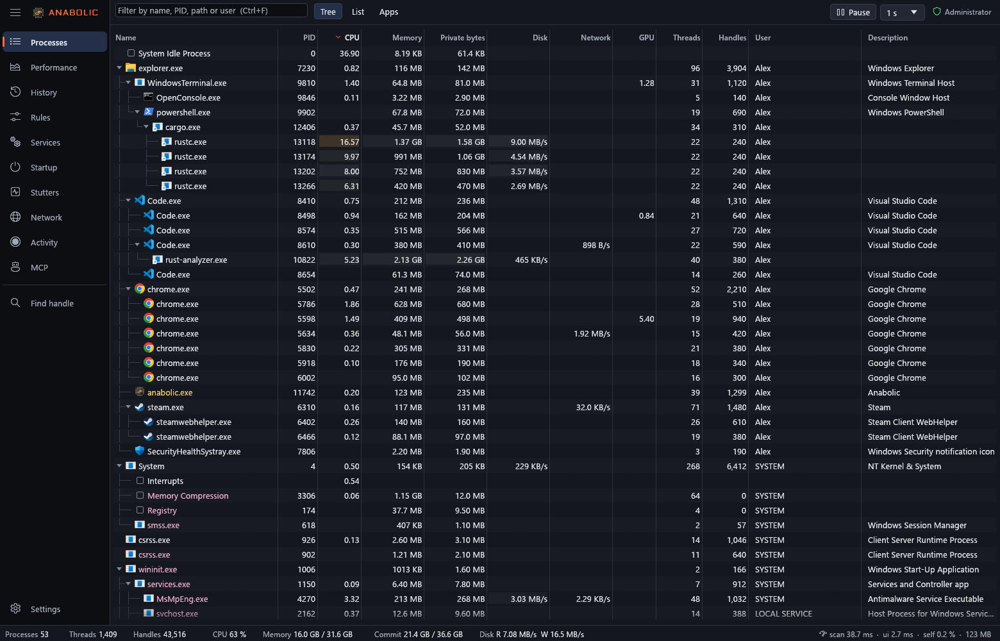

# Anabolic

**Task Manager on steroids.** An open-source performance monitoring and
diagnostics tool for Windows and Linux. It stays responsive when the machine
does not, and answers *who is doing this, and why*, not only *how much*.



## Install

```
cargo install anabolic
```

builds it: Rust 1.95 or newer, on Windows with the MSVC toolchain; on Linux
no development packages are needed. `cargo binstall anabolic` takes the
Windows release build instead of compiling. Either way you get `anabolic`,
the window, and `anabolic-cli`, the terminal commands (`anabolic-cli ps`)
and the MCP server without a window (`anabolic-cli mcp`). A copy installed
with cargo is updated with cargo, not by Anabolic's own updater.

The [releases](https://github.com/RaptorTwentyOne/Anabolic/releases) have a
Windows installer and zips for Windows and Linux, each with its checksum
and a build attestation.

## What it does

- **Overview**: the whole machine at a glance, with the app behind each load
  and what needs attention.
- **Processes** as a tree, a list or by app; who started each one and how;
  what a hung thread waits for; which handles keep a dead process alive.
- **Performance**: who ran on each CPU core, which process reads and writes
  which file on each disk, the drives' health from SMART, GPUs and sensors.
- **Disk space**: what fills a drive, in the manner of WinDirStat and
  WizTree; an NTFS drive, as administrator, is read from its master file
  table in seconds.
- **Boots**: each start step by step, and how the session before it ended.
- **Profiler**: where a process spends its processor time, from a kernel
  trace, without opening the process.
- **Stutters**: frame times, 1 % lows and DPC/ISR time per driver.
- **Network**: traffic per program, every connection and DNS lookup.
- **Activity**: Process Monitor style recording of what a process touches.
- A 7-day **history**, **services**, **startup** programs, per-program
  **rules** with CPU and memory limits, and an optional **MCP server** for AI
  assistants, off until you turn it on.

Its regular views read system-wide tables and kernel traces: no process is
opened, read or injected into, so a game is left alone while it is watched.

The [repository](https://github.com/RaptorTwentyOne/Anabolic) has the full
description, the Linux differences, the keyboard and terminal commands, and
the [privacy](https://github.com/RaptorTwentyOne/Anabolic/blob/master/PRIVACY.md)
notes; [CHANGELOG.md](https://github.com/RaptorTwentyOne/Anabolic/blob/master/crates/anabolic/CHANGELOG.md)
says what changed in each release.

## License

MIT or Apache-2.0, at your option.
